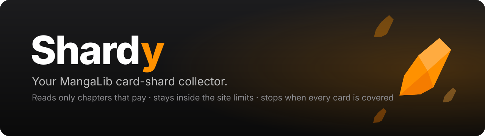
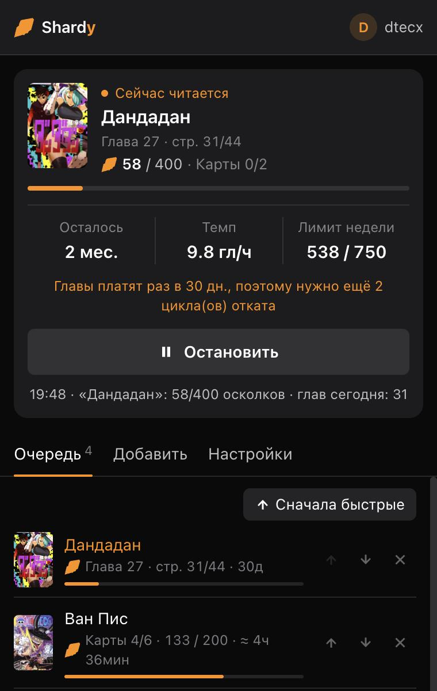
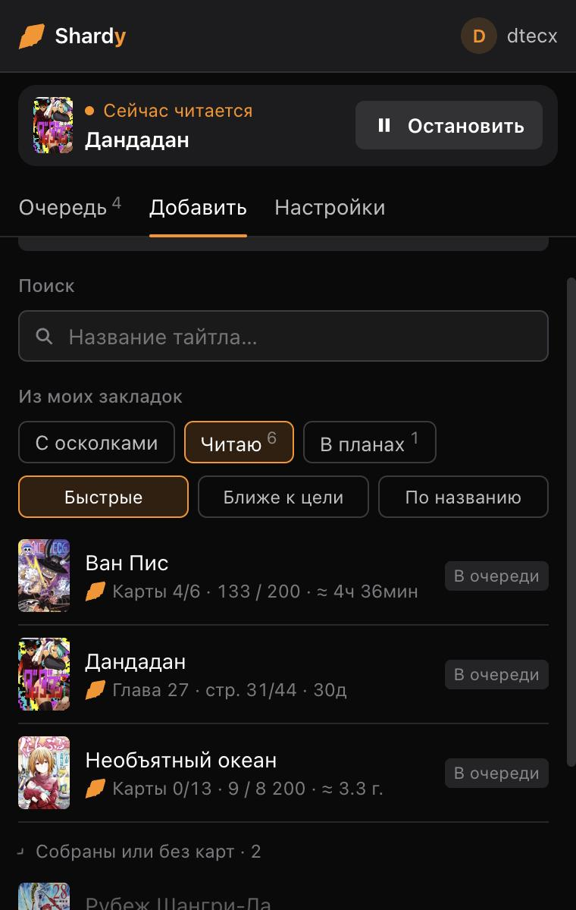
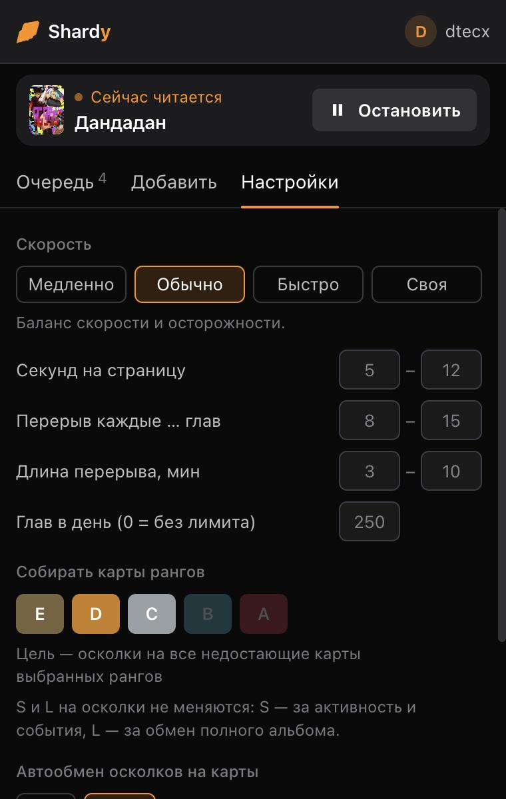

<p align="center">
  
</p>

<p align="center">
  <b>English</b> · <a href="README.ru.md">Русский</a> · <a href="README.uk.md">Українська</a>
</p>

<p align="center">
  
  
  
  
  
</p>

**Shardy** is a Chrome extension that collects card shards on [MangaLib](https://mangalib.me) for you. Pick the titles whose cards you want; Shardy reads their chapters page by page at a human pace, but only the chapters that actually pay shards right now. It stays inside the site's weekly limit and moves to the next title as soon as the current one has enough shards for every missing card.

<p align="center">
  
  &nbsp;
  
  &nbsp;
  
</p>

## Features

- **Reads only what pays.** Each chapter gives shards once per 30 days. Shardy checks every chapter's last counted read and skips the ones still on cooldown, so no time goes into reading for nothing.
- **Knows the limits.** It reads the live weekly shard limit from the site and pauses until the Monday reset when it is used up.
- **Farms exactly what you need.** For each title it adds up the missing cards of the ranks you chose × their exchange cost, then moves on. Already have half the album? It farms only the other half.
- **Smart import.** Pick a bookmark folder (Читаю, В планах…) or "С осколками" (titles where you already have shards). Every title shows its cards, the shards it still needs and the time left. Finished albums and titles without cards are folded away. Sort by fastest, closest to done or name, then add one by one or all at once.
- **An honest time estimate.** The estimate uses each title's real chapter length, your measured seconds per page and shards per chapter, breaks, the daily cap, the weekly limit and 30-day cooldown cycles. It updates on every page turn.
- **Optional auto-exchange.** Off by default, so opening the cards stays your fun. When it's on, it only buys ranks that still have missing cards, so it never produces duplicates.
- **Leaves your bookmarks alone.** Reading moves your "continue reading" mark; Shardy saves yours before a title and puts it back at breaks, when the title is done and on Stop.
- **Runs in the background.** Reading happens in its own small window, and its timer runs in the service worker, which Chrome doesn't slow down for hidden tabs.
- **Handles ads.** Shardy never clicks an ad. A full-screen ad between chapters stays up for a few seconds, then Shardy closes or hides it. If the reader stops responding, it reloads the chapter.
- **Looks like MangaLib.** The popup uses the site's own colors and rank colors, has light and dark themes, and comes in Russian and Ukrainian.

## How MangaLib's shard rules work

Checked against the site's code, its API and the official "Глобальное обновление карт" announcement:

| Rule | Value |
|---|---|
| Weekly limit for reading | **750** shards (900 with premium), plus up to 250 for comments and likes; resets Monday 06:00 UTC |
| Chapter cooldown | **30 days** per chapter (server constant `chapterReadRewardCooldownSeconds`) |
| When a chapter counts | after 90% of its pages (sometimes from 60%); the last chapter counts too |
| Reward | 1–2 shards per chapter, regardless of length |
| Exchange | gives a random card of the chosen rank that you don't have yet; duplicates only once a rank is complete |
| Exchangeable ranks | E, D, C, B, A. S cards come from activity and events; L cards come from trading in a full album |
| Where shards go | each title's album, and only that album |

> [!NOTE]
> Because chapters pay once a month, big albums take a long time. Необъятный океан (13 cards, 8,200 shards, 143 chapters) needs years. A small album needs weeks. Sorting by "Быстрые" puts the quick ones first.

## Install

1. Download this repository (**Code → Download ZIP**) and unzip it.
2. Open `chrome://extensions` and turn on **Developer mode**.
3. Click **Load unpacked** and choose the `extension` folder.
4. Log in on mangalib.me and keep one MangaLib tab open; the popup checks your account through it.

## Use

1. **Добавить:** search a title, pick titles from a bookmark folder, or add the title open in the current tab.
2. **Очередь:** order the titles with ↑ ↓, or press "Сначала быстрые".
3. **Настройки:** speed (Медленно / Обычно / Быстро / Своя), chapters per day, card ranks, auto-exchange, language.
4. Press **Начать фарм**. A small reading window opens; you can put other windows over it, but don't close it.

The start button stays disabled until you are logged in on MangaLib.

## FAQ

<details>
<summary><b>Can a card I already have drop again?</b></summary>

Not while the rank still has missing cards: an exchange always gives a missing card of that rank. Duplicates only come once the rank is complete, and Shardy's auto-exchange never buys a rank that is complete.
</details>

<details>
<summary><b>Why does it say months or years?</b></summary>

Each chapter pays once per 30 days, so a title can give only about (its chapters × 1.4) shards a month. A big album simply needs many cooldown cycles. Shardy shows that up front instead of pretending.
</details>

<details>
<summary><b>Will it mess up where I stopped reading?</b></summary>

No. Your "continue reading" mark is saved before Shardy reads a title and restored at every break, when the title is done and when you press Stop. If a title had no mark before, the one created while reading stays; you can remove it on the site.
</details>

<details>
<summary><b>What does it send, and where?</b></summary>

Only the requests the MangaLib reader itself makes (opening chapters, turning pages, reading your shard balance and bookmarks), sent with your own session to MangaLib's API. There is no server of its own and no analytics. Settings and the cache stay in Chrome's extension storage.
</details>

<details>
<summary><b>Is this allowed?</b></summary>

Automated reading is likely against MangaLib's rules, and there is always a risk for the account. Shardy keeps a human pace, takes breaks, stays inside the limits and doesn't touch comments or likes, but it can't make the risk zero. Use it at your own risk.
</details>

## Project layout

```
extension/            the extension itself (load this folder in Chrome)
  manifest.json
  background.js       service worker: farm window, timer, cover-image header rule
  content.js          runs on mangalib.me: chapter planner, page turning, limits, bookmarks
  popup.html / .js    the popup UI
  shared.js           card math, time estimate, RU/UA strings (used by popup and content script)
  icons/
tests/shared.test.js  self-check for the card math and the time estimate
docs/                 banner and screenshots
```

There is no build step and no dependencies. To run the self-check:

```bash
node tests/shared.test.js
```

## Disclaimer

Shardy is an unofficial fan project. It is not affiliated with or endorsed by MangaLib. All MangaLib names, card art and covers belong to their owners.

## License

[MIT](LICENSE)
