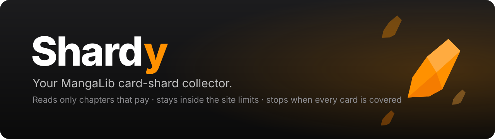
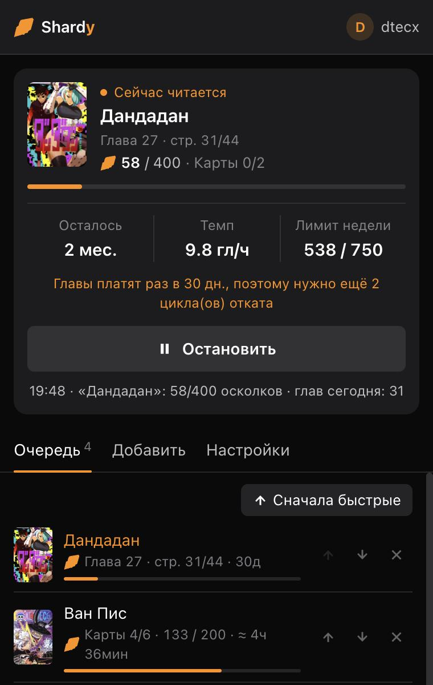
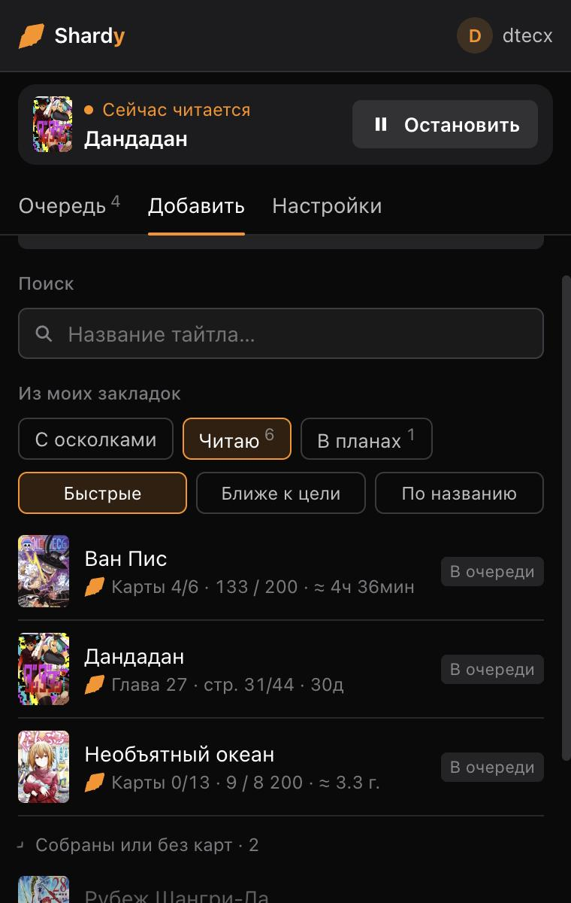
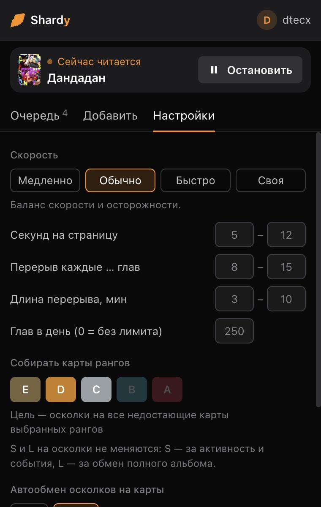
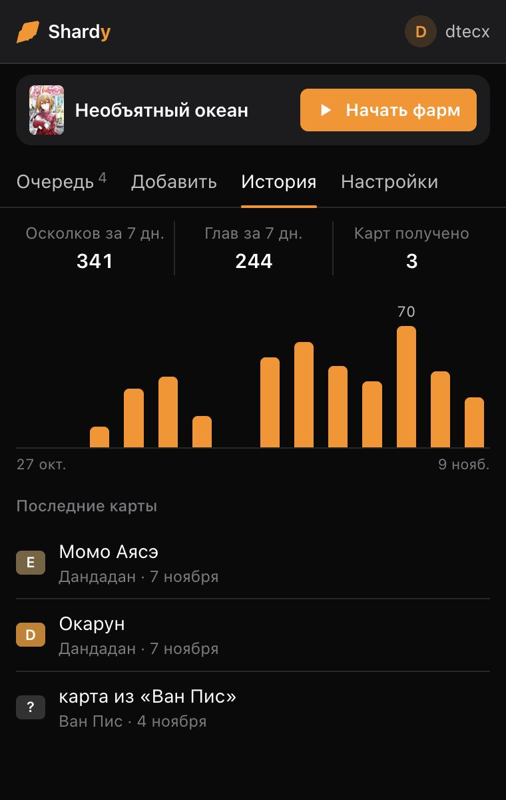

<p align="center">
  
</p>

<p align="center">
  <a href="README.md">English</a> · <b>Русский</b> · <a href="README.uk.md">Українська</a>
</p>

<p align="center">
  
  
  
  
  
</p>

**Shardy** — расширение для Chrome, которое собирает за вас осколки карт на [MangaLib](https://mangalib.me). Вы выбираете тайтлы, карты которых хотите получить. Shardy читает их главы постранично в человеческом темпе, но только те главы, которые прямо сейчас дают осколки. Расширение не выходит за недельный лимит сайта и переходит к следующему тайтлу, как только у текущего набралось осколков на все недостающие карты.

<p align="center">
  
  &nbsp;
  
  &nbsp;
  
  &nbsp;
  
</p>

## Возможности

- **Читает только то, что платит.** Каждая глава даёт осколки раз в 30 дней. Shardy проверяет, когда глава в последний раз засчитывалась, и пропускает главы на откате, чтобы не тратить время впустую.
- **Знает лимиты.** Берёт с сайта актуальный недельный лимит осколков и, когда он исчерпан, ждёт сброса в понедельник.
- **Фармит ровно столько, сколько нужно.** Для каждого тайтла считает: недостающие карты выбранных рангов × стоимость обмена. Потом переходит дальше. Уже есть половина альбома? Будет фармить только вторую половину.
- **Умный импорт.** Выберите папку закладок (Читаю, В планах…) или «С осколками» (тайтлы, где у вас уже есть осколки). Для каждого тайтла видно, сколько карт собрано, сколько осколков ещё нужно и сколько времени это займёт. Собранные альбомы и тайтлы без карт свёрнуты внизу. Сортировка: быстрые, ближе к цели, по названию. Добавлять можно по одному или все сразу.
- **Честная оценка времени.** Учитывает реальную длину глав каждого тайтла, ваши секунды на страницу и осколки за главу, перерывы, лимит глав в день, недельный лимит и 30-дневные циклы отката. Обновляется с каждой перевёрнутой страницей.
- **Автообмен — по желанию.** По умолчанию выключен, чтобы открывать карты было вашим удовольствием. Если включить, меняет осколки только на ранги, где ещё есть недостающие карты, поэтому дубликатов не будет.
- **Не сбивает закладку.** Чтение двигает ваше «Продолжить читать». Shardy сохраняет вашу закладку перед тайтлом и возвращает её на перерывах, когда тайтл готов и при остановке.
- **Работает в фоне.** Читает в своём маленьком окне, а таймер работает в service worker, который Chrome не замедляет для скрытых вкладок.
- **Справляется с рекламой.** Никогда не нажимает на рекламу. Полноэкранную рекламу между главами оставляет на экране на несколько секунд, потом закрывает или скрывает её. Если читалка перестала отвечать, перезагружает главу.
- **Уведомления.** Уведомление на рабочем столе, когда у тайтла хватает осколков, получена карта, исчерпан недельный лимит или готова вся очередь. Отключаются одним переключателем.
- **История.** Осколки и главы по дням за последние две недели, итоги за 7 дней и список полученных карт.
- **Новые версии.** Когда на GitHub Releases выходит новая версия, в окне появляется ссылка на неё.
- **Несколько аккаунтов.** У каждого аккаунта MangaLib своя очередь, история и сохранённые закладки. Вышли из аккаунта — фарм останавливается; вошли в другой — загружаются его данные; вернулись — ваши на месте.
- **Свой темп.** Пауза на страницу в мс, с или мин (от 100 мс) и длина перерыва в с или мин.
- **Очередь в файл.** Экспорт очереди в JSON-файл и импорт в другом браузере — или поделитесь списком с другом.
- **Выглядит как MangaLib.** Окно использует цвета сайта и цвета рангов, есть светлая и тёмная темы, интерфейс на русском и украинском.

## Как работают осколки на MangaLib

Проверено по коду сайта, его API и официальному посту «Глобальное обновление карт»:

| Правило | Значение |
|---|---|
| Недельный лимит за чтение | **750** осколков (900 с премиумом) и ещё до 250 за комментарии и лайки; сброс в понедельник в 06:00 UTC (09:00 по Москве) |
| Откат главы | **30 дней** на главу (серверная константа `chapterReadRewardCooldownSeconds`) |
| Когда глава засчитывается | после 90% страниц (иногда уже с 60%); последняя глава тоже считается |
| Награда | 1–2 осколка за главу, длина главы не важна |
| Обмен | случайная карта выбранного ранга, которой у вас ещё нет; дубликаты — только когда ранг собран полностью |
| Какие ранги меняются | E, D, C, B, A. Карты S — только за активность и события; L — за обмен полного альбома |
| Куда идут осколки | в альбом конкретного тайтла, и тратить их можно только там |

> [!NOTE]
> Главы платят раз в месяц, поэтому большие альбомы собираются долго. Необъятный океан (13 карт, 8 200 осколков, 143 главы) — это годы. Маленький альбом — недели. Сортировка «Быстрые» ставит быстрые тайтлы первыми.

## Установка

1. Скачайте `shardy-vX.Y.Z.zip` со страницы [Releases](https://github.com/dtecx/shardy/releases/latest) и распакуйте.
2. Откройте `chrome://extensions` и включите **Режим разработчика**.
3. Нажмите **Загрузить распакованное расширение** и выберите распакованную папку `shardy`.

Чтобы обновиться, распакуйте новую версию в ту же папку с заменой файлов и нажмите кнопку перезагрузки на карточке расширения. Не переносите папку: Chrome привязывает данные распакованного расширения к его папке, и копия из другого места начнёт с пустой очереди.
4. Войдите на mangalib.me и держите открытой одну вкладку MangaLib — через неё окно расширения проверяет аккаунт.

## Как пользоваться

1. **Добавить:** найдите тайтл поиском, выберите тайтлы из папки закладок или добавьте тайтл из текущей вкладки.
2. **Очередь:** расставьте тайтлы кнопками ↑ ↓ или нажмите «Сначала быстрые».
3. **Настройки:** скорость (Медленно / Обычно / Быстро / Своя), глав в день, ранги карт, автообмен, язык.
4. Нажмите **Начать фарм**. Откроется маленькое окно для чтения: его можно перекрыть другими окнами, но не закрывайте его.

Пока вы не вошли на MangaLib, кнопка запуска неактивна.

## Вопросы и ответы

<details>
<summary><b>Может ли выпасть карта, которая у меня уже есть?</b></summary>

Нет, пока в ранге есть недостающие карты: обмен всегда даёт недостающую карту этого ранга. Дубликаты появляются только когда ранг собран полностью, а автообмен Shardy никогда не покупает собранный ранг.
</details>

<details>
<summary><b>Почему показывает месяцы или годы?</b></summary>

Каждая глава платит раз в 30 дней, поэтому тайтл даёт примерно (число глав × 1,4) осколков в месяц. Большому альбому просто нужно много циклов отката. Shardy показывает это сразу, а не делает вид, что всё быстро.
</details>

<details>
<summary><b>Не собьётся ли место, где я остановился?</b></summary>

Нет. Ваша закладка «Продолжить читать» сохраняется перед тем, как Shardy начнёт читать тайтл, и возвращается на каждом перерыве, когда тайтл готов и при нажатии «Остановить». Если закладки у тайтла раньше не было, останется та, что создалась при чтении; её можно удалить на сайте.
</details>

<details>
<summary><b>Что и куда расширение отправляет?</b></summary>

Только те запросы, которые делает сама читалка MangaLib: открыть главу, перелистнуть страницу, узнать баланс осколков и закладки. Они идут в API MangaLib с вашей же сессией. Своего сервера и аналитики нет. Настройки и кэш хранятся в хранилище расширения в Chrome.
</details>

<details>
<summary><b>А это вообще разрешено?</b></summary>

Автоматическое чтение, скорее всего, нарушает правила MangaLib, и риск для аккаунта есть всегда. Shardy читает в человеческом темпе, делает перерывы, не выходит за лимиты и не трогает комментарии и лайки, но обнулить риск нельзя. Используйте на свой страх и риск.
</details>

## Структура проекта

```
extension/            само расширение (эту папку загружаете в Chrome)
  manifest.json
  background.js       service worker: окно чтения, таймер, заголовок для обложек
  content.js          работает на mangalib.me: выбор глав, перелистывание, лимиты, закладки
  popup.html / .js    окно расширения
  shared.js           расчёт карт, оценка времени, строки RU/UA (для окна и content script)
  icons/
tests/                самопроверки: расчёт карт и оценка времени, смена аккаунта
scripts/build.sh      локальная сборка архива для релиза
docs/                 баннер и скриншоты
```

Зависимостей нет. Самопроверка:

```bash
node tests/shared.test.js
node tests/accounts.test.js
```

Сборка архива для релиза (`dist/shardy-vX.Y.Z.zip`, версия берётся из `extension/manifest.json`):

```bash
./scripts/build.sh
```

## Отказ от ответственности

Shardy — неофициальный фанатский проект. Он не связан с MangaLib и не одобрен им. Все названия MangaLib, арты карт и обложки принадлежат их владельцам.

## Лицензия

[MIT](LICENSE)
