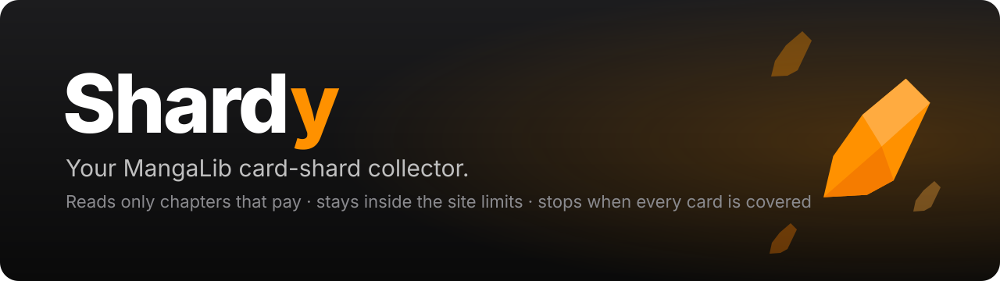
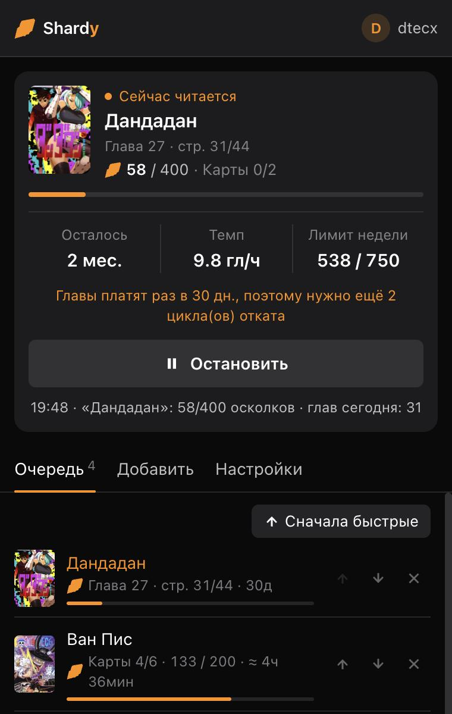
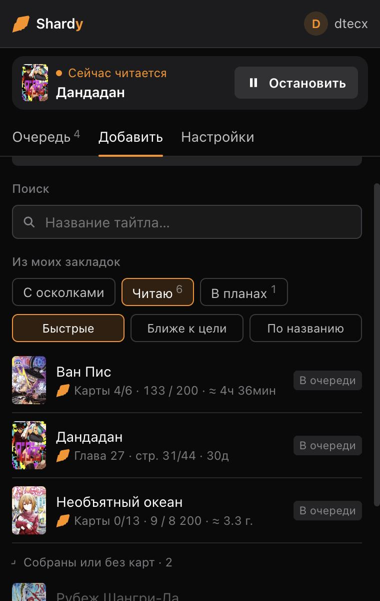
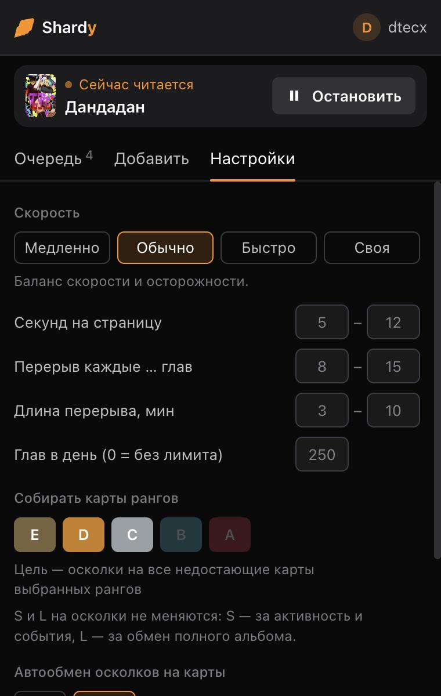
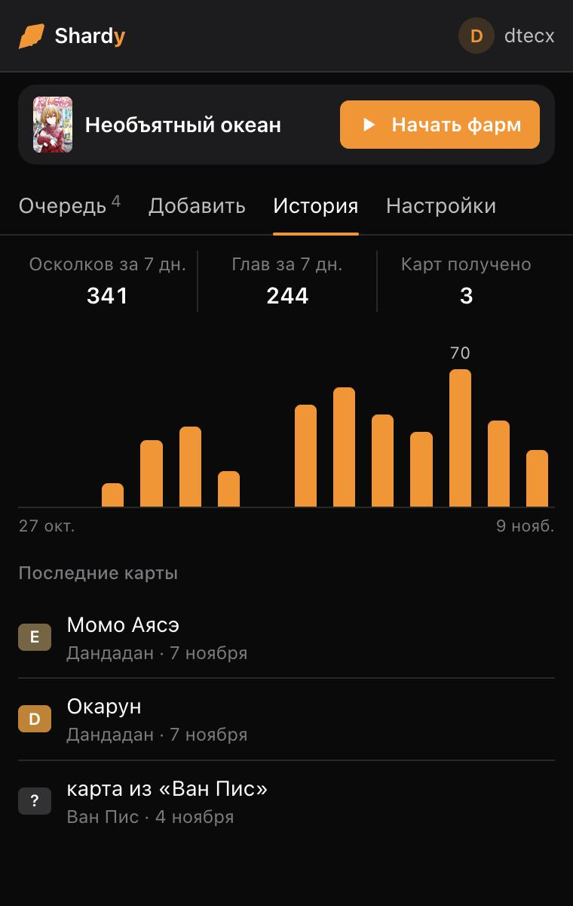

<p align="center">
  
</p>

<p align="center">
  <a href="README.md">English</a> · <a href="README.ru.md">Русский</a> · <b>Українська</b>
</p>

<p align="center">
  
  
  
  
  
</p>

**Shardy** — розширення для Chrome, яке збирає за вас уламки карт на [MangaLib](https://mangalib.me). Ви обираєте тайтли, карти яких хочете отримати. Shardy читає їхні розділи посторінково в людському темпі, але лише ті розділи, які просто зараз дають уламки. Розширення не виходить за тижневий ліміт сайту й переходить до наступного тайтлу, щойно в поточного назбиралося уламків на всі відсутні карти.

<p align="center">
  
  &nbsp;
  
  &nbsp;
  
  &nbsp;
  
</p>

> Скриншоти зроблено з російським інтерфейсом; українську мову вмикають у «Налаштуваннях».

## Можливості

- **Читає лише те, що платить.** Кожен розділ дає уламки раз на 30 днів. Shardy перевіряє, коли розділ востаннє зараховувався, і пропускає розділи на відкаті, щоб не витрачати час дарма.
- **Знає ліміти.** Бере із сайту актуальний тижневий ліміт уламків і, коли його вичерпано, чекає скидання в понеділок.
- **Фармить рівно стільки, скільки треба.** Для кожного тайтлу рахує: відсутні карти вибраних рангів × вартість обміну. Потім переходить далі. Уже є половина альбому? Фармитиме лише другу половину.
- **Розумний імпорт.** Оберіть папку закладок (Читаю, В планах…) або «З уламками» (тайтли, де у вас уже є уламки). Для кожного тайтлу видно, скільки карт зібрано, скільки уламків ще потрібно і скільки часу це займе. Зібрані альбоми й тайтли без карт згорнуто внизу. Сортування: швидкі, ближче до мети, за назвою. Додавати можна по одному або всі одразу.
- **Чесна оцінка часу.** Враховує реальну довжину розділів кожного тайтлу, ваші секунди на сторінку й уламки за розділ, перерви, ліміт розділів на день, тижневий ліміт і 30-денні цикли відкату. Оновлюється з кожною перегорнутою сторінкою.
- **Автообмін — за бажанням.** Типово вимкнений, щоб відкривати карти було вашим задоволенням. Якщо ввімкнути, міняє уламки лише на ранги, де ще є відсутні карти, тож дублікатів не буде.
- **Не збиває закладку.** Читання рухає ваше «Продовжити читати». Shardy зберігає вашу закладку перед тайтлом і повертає її на перервах, коли тайтл готовий і після зупинки.
- **Працює у фоні.** Читає у своєму маленькому вікні, а таймер працює в service worker, який Chrome не сповільнює для прихованих вкладок.
- **Дає раду рекламі.** Ніколи не натискає на рекламу. Повноекранну рекламу між розділами лишає на екрані на кілька секунд, потім закриває або ховає її. Якщо читалка перестала відповідати, перезавантажує розділ.
- **Сповіщення.** Сповіщення на робочому столі, коли тайтлу вистачає уламків, отримано карту, вичерпано тижневий ліміт або готова вся черга. Вимикаються одним перемикачем.
- **Історія.** Уламки й розділи по днях за останні два тижні, підсумки за 7 днів і список отриманих карт.
- **Нові версії.** Коли на GitHub Releases виходить нова версія, у вікні з'являється посилання на неї.
- **Кілька акаунтів.** У кожного акаунта MangaLib своя черга, історія та збережені закладки. Вийшли з акаунта — фарм зупиняється; увійшли в інший — завантажуються його дані; повернулися — ваші на місці.
- **Свій темп.** Пауза на сторінку в мс, с або хв (від 100 мс) і тривалість перерви в с або хв.
- **Черга у файл.** Експорт черги в JSON-файл та імпорт в іншому браузері — або поділіться списком із другом.
- **Виглядає як MangaLib.** Вікно використовує кольори сайту й кольори рангів, є світла й темна теми, інтерфейс українською та російською.

## Як працюють уламки на MangaLib

Перевірено за кодом сайту, його API та офіційним дописом «Глобальное обновление карт»:

| Правило | Значення |
|---|---|
| Тижневий ліміт за читання | **750** уламків (900 із преміумом) і ще до 250 за коментарі та лайки; скидання в понеділок о 06:00 UTC (08:00 за Києвом узимку, 09:00 улітку) |
| Відкат розділу | **30 днів** на розділ (серверна константа `chapterReadRewardCooldownSeconds`) |
| Коли розділ зараховується | після 90% сторінок (іноді вже з 60%); останній розділ теж рахується |
| Нагорода | 1–2 уламки за розділ, довжина розділу не важлива |
| Обмін | випадкова карта вибраного рангу, якої у вас ще немає; дублікати — лише коли ранг зібрано повністю |
| Які ранги обмінюються | E, D, C, B, A. Карти S — лише за активність і події; L — за обмін повного альбому |
| Куди йдуть уламки | в альбом конкретного тайтлу, і витрачати їх можна лише там |

> [!NOTE]
> Розділи платять раз на місяць, тому великі альбоми збираються довго. Необъятный океан (13 карт, 8 200 уламків, 143 розділи) — це роки. Маленький альбом — тижні. Сортування «Швидкі» ставить швидкі тайтли першими.

## Встановлення

1. Завантажте `shardy-vX.Y.Z.zip` зі сторінки [Releases](https://github.com/dtecx/shardy/releases/latest) і розпакуйте.
2. Відкрийте `chrome://extensions` і ввімкніть **Режим розробника**.
3. Натисніть **Завантажити розпаковане розширення** й оберіть розпаковану папку `shardy`.

Щоб оновитися, розпакуйте нову версію в ту саму папку із заміною файлів і натисніть кнопку перезавантаження на картці розширення. Не переносьте папку: Chrome прив'язує дані розпакованого розширення до його папки, і копія з іншого місця почне з порожньої черги.
4. Увійдіть на mangalib.me і тримайте відкритою одну вкладку MangaLib — через неї вікно розширення перевіряє акаунт.

## Як користуватися

1. **Додати:** знайдіть тайтл пошуком, оберіть тайтли з папки закладок або додайте тайтл із поточної вкладки.
2. **Черга:** розставте тайтли кнопками ↑ ↓ або натисніть «Спочатку швидкі».
3. **Налаштування:** швидкість (Повільно / Звичайно / Швидко / Своя), розділів на день, ранги карт, автообмін, мова.
4. Натисніть **Почати фарм**. Відкриється маленьке вікно для читання: його можна перекрити іншими вікнами, але не закривайте його.

Доки ви не увійшли на MangaLib, кнопка запуску неактивна.

## Питання та відповіді

<details>
<summary><b>Чи може випасти карта, яка в мене вже є?</b></summary>

Ні, доки в ранзі є відсутні карти: обмін завжди дає відсутню карту цього рангу. Дублікати з'являються лише тоді, коли ранг зібрано повністю, а автообмін Shardy ніколи не купує зібраний ранг.
</details>

<details>
<summary><b>Чому показує місяці або роки?</b></summary>

Кожен розділ платить раз на 30 днів, тож тайтл дає приблизно (кількість розділів × 1,4) уламків на місяць. Великому альбому просто потрібно багато циклів відкату. Shardy показує це одразу, а не вдає, що все швидко.
</details>

<details>
<summary><b>Чи не зіб'ється місце, де я зупинився?</b></summary>

Ні. Ваша закладка «Продовжити читати» зберігається перед тим, як Shardy почне читати тайтл, і повертається на кожній перерві, коли тайтл готовий і після натискання «Зупинити». Якщо закладки в тайтлу раніше не було, лишиться та, що створилася під час читання; її можна видалити на сайті.
</details>

<details>
<summary><b>Що й куди розширення надсилає?</b></summary>

Лише ті запити, які робить сама читалка MangaLib: відкрити розділ, перегорнути сторінку, дізнатися баланс уламків і закладки. Вони йдуть до API MangaLib із вашою ж сесією. Власного сервера й аналітики немає. Налаштування й кеш зберігаються у сховищі розширення в Chrome.
</details>

<details>
<summary><b>А це взагалі дозволено?</b></summary>

Автоматичне читання, найімовірніше, порушує правила MangaLib, і ризик для акаунта є завжди. Shardy читає в людському темпі, робить перерви, не виходить за ліміти й не чіпає коментарі та лайки, але звести ризик до нуля неможливо. Використовуйте на власний ризик.
</details>

## Структура проєкту

```
extension/            саме розширення (цю папку завантажуєте в Chrome)
  manifest.json
  background.js       service worker: вікно читання, таймер, заголовок для обкладинок
  content.js          працює на mangalib.me: вибір розділів, гортання, ліміти, закладки
  popup.html / .js    вікно розширення
  shared.js           розрахунок карт, оцінка часу, рядки RU/UA (для вікна й content script)
  icons/
tests/                самоперевірки: розрахунок карт і оцінка часу, зміна акаунта
scripts/build.sh      локальне збирання архіву для релізу
docs/                 банер і скриншоти
```

Залежностей немає. Самоперевірка:

```bash
node tests/shared.test.js
node tests/accounts.test.js
```

Збирання архіву для релізу (`dist/shardy-vX.Y.Z.zip`, версія береться з `extension/manifest.json`):

```bash
./scripts/build.sh
```

## Відмова від відповідальності

Shardy — неофіційний фанатський проєкт. Він не пов'язаний із MangaLib і не схвалений ним. Усі назви MangaLib, арти карт і обкладинки належать їхнім власникам.

## Ліцензія

[MIT](LICENSE)
